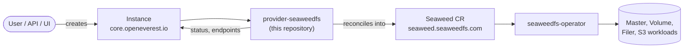

# SeaweedFS Provider

> [!WARNING]
> **MVP.** This provider is an early prototype. OpenEverest v2 and this provider are under
> active development. CRD schemas, chart values and defaults change frequently, including in
> breaking ways, and there is no supported upgrade path between versions yet. Not for
> production use.

<!-- Remove the MVP banner and the status badge when the provider leaves MVP. -->

[](https://github.com/openeverest/openeverest)
[](https://github.com/openeverest/provider-seaweedfs/actions/workflows/CI.yaml)
[](LICENSE)

Run **SeaweedFS** — distributed object storage with an S3-compatible gateway — on Kubernetes
through [OpenEverest](https://github.com/openeverest/openeverest), backed by the
[`seaweedfs-operator`](https://github.com/seaweedfs/seaweedfs-operator).

## What this is

OpenEverest providers translate a single, technology-agnostic `Instance` custom
resource into the native custom resources of an upstream Kubernetes operator —
for databases, but equally for caches, message queues, object storage, or
model-serving runtimes. This repository is the provider for **SeaweedFS**: it owns
the technology-specific knowledge — topologies, versions, and component layout —
so that users, the API server, and the UI stay technology-agnostic.

SeaweedFS is **not a database**. It is a distributed file system and object store
(masters, volume servers, filer, and an optional S3 gateway). This provider
provisions that stack; it does not manage relational or document data stores.

> [!IMPORTANT]
> **This provider is not standalone.** It requires an OpenEverest installation
> (core CRDs and controller) in the cluster. Installing this chart on its own
> does nothing. See [Install OpenEverest](https://openeverest.io/documentation/current/quick-install.html).



The provider watches `Instance` resources whose `spec.providerRef.name` is
`provider-seaweedfs`, and reports workload health back onto `Instance.status`.
It never manages pods directly — all lifecycle work is delegated to the operator.

## Compatibility

| provider-seaweedfs | OpenEverest | seaweedfs-operator | Kubernetes |
|---|---|---|---|
| `0.1.x` (MVP) | `2.0.0-dev.x` | chart `0.1.43` (image `1.0.40`) | `1.30` – `1.34` |

The chart dependency installs `chrislusf/seaweedfs-operator:1.0.40`.
The provider binary still compiles against the Go module pin in
[go.mod](go.mod) (`v0.0.0-20260904022014-736537efa750`, commit time
2026-09-04). That pin was not moved with the chart. The fields this provider
writes on `Seaweed` are already in that module.

Chart `0.1.42` (image `1.0.39`) changes admin startup and ServiceMonitor
scraping, plus dependencies. This provider sets `spec.admin` (see Admin UI
below) and does not set `spec.admin.metricsPort`, so it does not create the
admin ServiceMonitor.

Chart `0.1.43` (image `1.0.40`) changes Instance behavior beyond that. The GitHub release notes for `1.0.40`
only mention a SeaweedFS library bump. The tag also contains
[seaweedfs-operator#394](https://github.com/seaweedfs/seaweedfs-operator/pull/394)
(in-place PVC growth) and
[#391](https://github.com/seaweedfs/seaweedfs-operator/pull/391)
(`[grpc.s3]` in `security.toml`, and the S3 Service DNS name on the server
certificate). It also changes how `S3Credentials` adopts Secrets; this
provider does not reconcile that CRD.

### Minimum operator version for IAM, bucket, and backup CRDs

`S3Identity`, `S3Credentials`, `S3Policy`, `S3PolicyBinding`, `Bucket`,
`BucketLifecyclePolicy`, `SeaweedBackup`, and `SeaweedRestore` are installed by
the seaweedfs-operator chart. This provider does not reconcile any of them.
The versions below are the first published chart whose CRD manifest contains
the kind, and the operator image (`appVersion`) that chart installs. Checked
against the Helm index at <https://seaweedfs.github.io/seaweedfs-operator/>
on 2026-10-16.

| CRDs | First chart | Operator image |
|---|---|---|
| `Bucket` | `0.1.17` | `1.0.14` |
| `S3Identity`, `S3Credentials`, `S3Policy`, `S3PolicyBinding` | `0.1.24` | `1.0.21` |
| `BucketLifecyclePolicy`, `SeaweedBackup`, `SeaweedRestore` | `0.1.30` | `1.0.27` |

`Bucket` is absent from chart `0.1.16` (image `1.0.13`). The IAM kinds landed in
[seaweedfs-operator#255](https://github.com/seaweedfs/seaweedfs-operator/pull/255),
which is in image `1.0.21` and chart `0.1.24` (chart `0.1.23` / image `1.0.20`
does not have them). `SeaweedBackup` / `SeaweedRestore`
([#302](https://github.com/seaweedfs/seaweedfs-operator/pull/302), merged
2026-06-17) and `BucketLifecyclePolicy`
([#304](https://github.com/seaweedfs/seaweedfs-operator/pull/304), merged
2026-06-21) both landed after image `1.0.26` (published 2026-06-15, chart
`0.1.29`) and are in chart `0.1.30` / image `1.0.27` (published 2026-06-22).
The `1.0.27` GitHub release notes only mention a SeaweedFS library bump; the
CRDs are in that chart's manifest anyway.

**Minimum for the full set is chart `0.1.30` / operator image `1.0.27`.**
The dependency above (`0.1.43` / `1.0.40`) is past that floor.

## Capabilities

What you can do to a running instance through the `Instance` API today. This is
an MVP: several capabilities are stubbed or not wired yet.

| Capability | Status | Notes |
|---|---|---|
| Provisioning | ✅ | Creates a `Seaweed` CR with master, volume, filer, and S3 components |
| Horizontal scaling | ✅ | Per-component `spec.components.*.replicas` (master must be odd) |
| Vertical scaling (CPU / memory) | ✅ | `spec.components.*.resources` (requests and limits) is copied onto master, volume, filer, and S3 |
| Version selection | ✅ | `spec.version` / component image from [definition/versions.yaml](definition/versions.yaml) |
| High availability | ⚠️ | Replica counts are passed through. Data copies follow `topology.parameters.replication` (`master.defaultReplication`); empty uses `001` with at least 2 volume servers, otherwise `000`. Placements that need another data center or rack are rejected |
| Custom configuration | ✅ | Master `masterVolumeSizeLimitMB`; topology `replication` and `volumeServerDiskCount`; volume `maxVolumeCounts`; filer `maxMB`; S3 `port` / `domainName` / Ingress; JWT signing via `topology.parameters.securityConfig` |
| S3 service exposure | ✅ | `spec.components.s3.service.serviceType`: ClusterIP, NodePort, or LoadBalancer. `loadBalancerService.sourceRanges` is rejected. Only S3 can be exposed |
| Admin UI | ✅ | Off unless `topology.parameters.admin.enabled` is true. This provider creates Secret `<instance>-admin-credentials` with `adminUser=admin` and a generated `adminPassword` (kept across reconciles). ClusterIP Service `<instance>-admin`, port 23646. Connection details add `adminURL`, `adminUser`, and `adminCredentialsSecret` (the Secret name). Operator image `1.0.40` exits the admin container when `adminPassword` is missing. Workers are not created |
| Monitoring | ❌ | Not wired through the Instance API. The operator chart can enable `serviceMonitor` on its own (`enabled: false` by default); this provider does not set it |
| TLS | ✅ | Inter-component gRPC mTLS via `topology.parameters.tls`. Client HTTPS via S3 Ingress TLS (`components.s3.parameters.ingress`) → `externalEndpointURL=https://…`. Native S3 HTTPS on the gateway is not supported by the operator yet ([seaweedfs-operator#411](https://github.com/seaweedfs/seaweedfs-operator/issues/411)) |
| Status / readiness | ✅ | Maps Seaweed Ready condition; waits for TLS Secret / LoadBalancer / Ingress when configured |
| Connection details | ✅ | Publishes in-cluster S3 endpoint on Ready; NodePort / LoadBalancer / Ingress add `externalEndpointURL`. Admin UI adds `adminURL`, `adminUser`, and `adminCredentialsSecret` |
| Pod scheduling | ✅ | `schedulingPolicy` affinity, nodeSelector, tolerations and schedulerName, written on each Seaweed component. Master, volume and filer pods prefer separate nodes (preferred anti-affinity on hostname, weight 100); `affinity: {}` opts out. S3 has no default affinity. `topologySpreadConstraints` is rejected (no seaweedfs-operator field) |

Stateful workloads additionally report:

| Capability | Status | Notes |
|---|---|---|
| Persistent storage | ✅ | Volume/filer `storage.size` required; optional master `storage.size`. Optional per-component `storage.storageClass` (UI picker for master/volume/filer) |
| Storage expansion | ✅ | Volume, filer, and master `storage.size` can grow. A smaller size is rejected. Master `storage.size` cannot be set after creation when the master has no persistence, because the operator deletes and recreates the master StatefulSet. A larger size is rejected unless the StorageClass already on the Seaweed spec has `allowVolumeExpansion: true`, or the newest default class when the spec names none. Changing `storage.storageClass` in the same request as a size increase is rejected. Image `1.0.40` then patches the live PVCs and leaves StatefulSet `volumeClaimTemplates` unchanged ([seaweedfs-operator#394](https://github.com/seaweedfs/seaweedfs-operator/pull/394)). While a PVC is `Resizing`, or the operator has not patched it yet, the Instance phase is `Updating`. `FileSystemResizePending` does not hold the phase; offline expansion needs a pod restart. If the class on the PVC disallows expansion, the phase is `Failed`. Other claim-template edits are not applied; the operator emits Warning event `VolumeClaimTemplatesMismatch` (not a status condition) |
| Backups | ❌ | Not implemented. Operator chart `0.1.30` and later install a `SeaweedBackup` CRD; this provider does not create it |
| Restore | ❌ | Not implemented. `SeaweedRestore` ships in the same chart; this provider does not create it |

## Installation

The Helm chart and container image are published to GHCR on every tagged
[release](https://github.com/openeverest/provider-seaweedfs/releases). Pick a version
from the releases page:

```bash
helm install provider-seaweedfs \
  oci://ghcr.io/openeverest/charts/provider-seaweedfs \
  --version <version> \
  --namespace everest-system \
  --create-namespace
```

- The `seaweedfs-operator` (and its CRDs) is bundled as a chart dependency and is
  installed automatically when `seaweedfs-operator.enabled` is `true` (the default).

To run unreleased changes from `main`, install from the chart in this repository instead:

```bash
make helm-deps
helm install provider-seaweedfs charts/provider-seaweedfs \
  --namespace everest-system \
  --create-namespace
```

Upgrade and uninstall:

```bash
helm upgrade provider-seaweedfs \
  oci://ghcr.io/openeverest/charts/provider-seaweedfs \
  --version <version> \
  --namespace everest-system
helm uninstall provider-seaweedfs --namespace everest-system
```

Uninstalling the chart does **not** delete running `Instance` resources or their data.

## Usage

Verify that the provider registered itself:

```bash
kubectl get providers.core.openeverest.io provider-seaweedfs
```

Create an instance:

```yaml
apiVersion: core.openeverest.io/v1alpha1
kind: Instance
metadata:
  name: seaweedfs-standalone
spec:
  providerRef:
    name: provider-seaweedfs
  components:
    master:
      type: seaweedfs
      version: "4.47"
      image: chrislusf/seaweedfs:4.47
      replicas: 1
    volume:
      type: seaweedfs
      replicas: 1
      storage:
        size: 10Gi
    filer:
      type: seaweedfs
      replicas: 1
      storage:
        size: 1Gi
    s3:
      type: seaweedfs
      replicas: 1
```

Component names are defined by this provider — see
[definition/provider.yaml](definition/provider.yaml). `spec.version` and
`spec.topology` are optional; the provider defaults apply. More examples live in
[examples/](examples/), including [TLS](examples/seaweedfs-standalone-tls.yaml) and
[S3 Ingress](examples/seaweedfs-standalone-s3-ingress.yaml).

Enable inter-component mTLS (requires cert-manager):

```yaml
spec:
  topology:
    type: standalone
    parameters:
      tls:
        enabled: true
        # optional — omit for the operator's self-signed CA
        # issuerRef:
        #   name: my-ca-issuer
        #   kind: ClusterIssuer
```

Expose S3 outside the cluster (NodePort / LoadBalancer), or terminate client HTTPS
at an Ingress — see [examples/seaweedfs-standalone-s3-ingress.yaml](examples/seaweedfs-standalone-s3-ingress.yaml):

```yaml
spec:
  components:
    s3:
      type: seaweedfs
      replicas: 1
      service:
        serviceType: LoadBalancer   # or NodePort
      # parameters:
      #   ingress:
      #     enabled: true
      #     host: s3.example.com
      #     tls:
      #       secretName: seaweed-s3-tls
```

Watch it come up:

```bash
kubectl get instance seaweedfs-standalone -w
kubectl get seaweed -A
```

> [!NOTE]
> When the Instance is Ready, connection details are published to Secret
> `<instance-name>-conn` from the operator-managed S3 Service
> (`<name>-s3`). They include host, port, URI, and
> `forcePathStyle=true` / `verifyTLS=false` hints for S3 clients.
>
> **TLS note:** `topology.parameters.tls.enabled` turns on **gRPC mTLS between
> SeaweedFS components** (master/volume/filer/S3 gRPC). The S3 Service stays
> plain HTTP — in-cluster `endpointURL` remains `http://…` with `verifyTLS=false`.
>
> For **client-facing HTTPS**, enable S3 Ingress TLS
> (`spec.components.s3.parameters.ingress`). Connection details then publish
> `externalEndpointURL=https://<host>` and `externalVerifyTLS` (default `true`).
> See [examples/seaweedfs-standalone-s3-ingress.yaml](examples/seaweedfs-standalone-s3-ingress.yaml).
>
> NodePort and LoadBalancer also publish `externalEndpointURL` (HTTP) when the
> service is assigned. The Instance stays Provisioning until a LoadBalancer
> ingress address appears (or until the TLS Secret / Ingress exists when those
> are enabled).
>
> Inter-component mTLS requires cert-manager; without it the Instance stays
> Provisioning until the `<name>-server-tls` Secret appears. seaweedfs-operator
> detects cert-manager CRDs once per process — restart it if cert-manager was
> installed after the operator started. Do not toggle `tls.enabled` on a live
> cluster: components roll one-by-one and TLS/non-TLS peers cannot talk mid-rollout.
>
> Optional JWT signing for volume/filer (`topology.parameters.securityConfig`) is
> supported via YAML/API only there is no UI for it yet.
>
> The admin UI is off until you enable it. This provider creates the
> credentials Secret; the username is `admin` and the password is generated
> once and reused:
>
> ```yaml
> spec:
>   topology:
>     type: standalone
>     parameters:
>       admin:
>         enabled: true
> ```
>
> The Secret is `<instance>-admin-credentials` (`adminUser`, `adminPassword`).
> Connection details name it in `adminCredentialsSecret` and do not copy the
> password. Read it with:
>
> ```bash
> kubectl get secret <instance>-admin-credentials \
>   -o jsonpath='{.data.adminPassword}' | base64 -d; echo
> ```
>
> The Service is ClusterIP `<instance>-admin` port 23646. Reach it with
> `kubectl port-forward svc/<instance>-admin 23646:23646` and open
> `http://localhost:23646`. The admin process reads the Secret only at start.
> Turning the UI off stops the server and leaves the Secret in place, so
> turning it back on keeps the same password.
>
> For Postgres backups, point a `BackupStorage` at the S3 endpoint. Without an
> S3 identity config on the gateway, SeaweedFS accepts requests without auth —
> create any credentials Secret with `AWS_ACCESS_KEY_ID` /
> `AWS_SECRET_ACCESS_KEY` for BackupStorage to reference, create the bucket
> (S3 API or the admin UI), then attach the storage to the Postgres Instance.
>
> ```yaml
> apiVersion: backup.openeverest.io/v1alpha1
> kind: BackupStorage
> metadata:
>   name: seaweedfs-backups
> spec:
>   type: s3
>   s3:
>     bucket: seaweedfs-standalone-backups
>     region: us-east-1
>     endpointURL: http://seaweedfs-standalone-s3.default.svc:8333
>     forcePathStyle: true
>     verifyTLS: false
>     credentialsSecretRef:
>       name: my-s3-creds
> ```

## Topologies

| Topology | Default | Description |
|---|---|---|
| `standalone` | ✅ | Single SeaweedFS deployment with master, volume, filer, and S3 gateway components |

## Versions

| Version bundle | Default | seaweedfs |
|---|---|---|
| `4.47` | ✅ | `4.47` (`chrislusf/seaweedfs:4.47`) |

Source of truth: [definition/versions.yaml](definition/versions.yaml).

## Configuration

- **Chart values:** [charts/provider-seaweedfs/values.yaml](charts/provider-seaweedfs/values.yaml)
- **Instance parameters:** per-component and per-topology schemas under
  [definition/](definition/), published on the `Provider` resource
  (`kubectl get provider provider-seaweedfs -o yaml`). The API server and the UI
  validate user input against these schemas.

Sync writes replica counts, CPU and memory resources, volume/filer/master
persistence (including storage class), S3 service type and Ingress, the admin
server when `topology.parameters.admin.enabled` is true (Secret
`<instance>-admin-credentials`, user `admin`, generated password), component
parameters (`masterVolumeSizeLimitMB`, `maxVolumeCounts`, `maxMB`, `port`,
`domainName`), topology `replication` and `volumeServerDiskCount`, optional
inter-component TLS (`topology.parameters.tls`), JWT signing
(`topology.parameters.securityConfig`), and pod scheduling (affinity,
nodeSelector, tolerations, schedulerName) onto the upstream `Seaweed` CR.
`topologySpreadConstraints` and load-balancer source ranges are rejected.
A larger volume, filer, or master `storage.size` is written through when the
StorageClass already on the Seaweed spec allows expansion. Operator image
`1.0.40` grows the PVCs (see the capabilities table). Shrinks are rejected.
Setting master `storage.size` when the master has no disk yet is rejected.
Changing `storage.storageClass` together with a size increase is rejected.
Monitoring, backups, and restores are not applied.

## Development

Requires Go (see [go.mod](go.mod)), Docker, Helm, kubectl, and a Kubernetes
cluster you can reach. For local development we recommend [k3d](https://k3d.io)
and [Tilt](https://tilt.dev/) — see [dev/README.md](dev/README.md).

```bash
make k3d-cluster-up    # local k3d cluster
make generate          # RBAC, provider spec, Helm chart sync
make run               # run the provider locally against the cluster
make test              # unit tests
make helm-install      # install chart (+ seaweedfs-operator dependency)
make dev-up            # k3d + Tilt (live-reload provider + OpenEverest)
make k3d-cluster-down
```

`make help` lists every target. `make verify` fails when generated files are
stale — run `make generate` and commit the result.

The provider contract (`Validate` / `Sync` / `Status` / `Cleanup`), RBAC
markers, watches, and code generation are documented once for all providers in
[PROVIDER_DEVELOPMENT.md](https://github.com/openeverest/provider-sdk/blob/main/PROVIDER_DEVELOPMENT.md).

### Layout

| Path | Purpose |
|---|---|
| `cmd/provider/` | Entry point |
| `internal/provider/` | `ProviderInterface` implementation, RBAC markers |
| `internal/common/` | Provider and component name constants |
| `definition/` | Provider identity, component types, versions, topologies |
| `charts/provider-seaweedfs/` | Helm chart (`generated/` is produced by `make generate`) |
| `config/rbac/role.yaml` | Generated `ClusterRole` — do not edit |
| `examples/` | Example `Instance` resources |
| `dev/` | k3d cluster config and Tilt setup |

### Testing

- **Unit tests** — `make test`.
- **Integration tests** — [chainsaw](https://kyverno.github.io/chainsaw/) suites in `test/integration/`. The seaweedfs-operator is scaled to 0 and the tests patch `Seaweed` status to simulate it, so they check the provider's mapping and status logic quickly. To run them locally:

  ```bash
  make k3d-cluster-up
  make docker-build load-image install-crds deploy-provider-ci IMG=provider-seaweedfs:ci
  # OpenEverest controller, built from an openeverest/openeverest checkout:
  (cd ../openeverest && make build-controller docker-build-controller)
  make load-openeverest-controller-image
  (cd ../openeverest && make deploy-test-controller)
  make test-integration            # or test-integration-core-standalone / -validation
  ```

## Troubleshooting

```bash
kubectl logs -n everest-system deploy/provider-seaweedfs -f
```

| Symptom | Where to look |
|---|---|
| `Instance` stuck in `Provisioning` | `kubectl describe instance <name>` conditions, then the provider logs. Common waits: Seaweed Ready, S3 Service, LoadBalancer ingress, S3 Ingress, or `<name>-server-tls` Secret when TLS is enabled |
| `Instance` stays `Updating` after a disk increase | `kubectl get pvc -o wide` for `Resizing`. Image `1.0.40` patches the PVC request and leaves the StatefulSet claim template unchanged. `FileSystemResizePending` does not keep the Instance in `Updating`. When the CSI driver only expands offline, restart the pod that mounts the PVC so the kubelet grows the filesystem. An older image only emits Warning event `VolumeClaimTemplatesMismatch` and does not grow the PVC. Deleting the StatefulSet does not resize claims that already exist. Patch each PVC yourself when `allowVolumeExpansion` is true: `kubectl patch pvc <name> --type=merge -p '{"spec":{"resources":{"requests":{"storage":"<size>"}}}}'`. Names are `mount<N>-<instance>-volume-<ordinal>`, `<instance>-filer-<instance>-filer-<ordinal>`, and `<instance>-master-<instance>-master-<ordinal>` |
| Disk increase rejected | The StorageClass needs `allowVolumeExpansion: true`. Shrinking `storage.size` is rejected |
| No `Provider` resource in the cluster | Is the chart installed? Check the provider deployment logs |
| `Instance` ignored entirely | `spec.providerRef.name` must be `provider-seaweedfs` |
| `Seaweed` resource created but no pods | Inspect the `Seaweed` custom resource status — the failure is upstream in the operator |
| TLS enabled but never Ready | Is [cert-manager](https://cert-manager.io) installed? Check for Certificate / Secret `<name>-server-tls`. seaweedfs-operator checks for cert-manager CRDs once per process (`sync.Once`); if cert-manager was installed after the operator started, restart the operator |

## Contributing

Issues and pull requests are welcome. See
[PROVIDER_DEVELOPMENT.md](https://github.com/openeverest/provider-sdk/blob/main/PROVIDER_DEVELOPMENT.md)
and the [OpenEverest Code of Conduct](https://github.com/openeverest/openeverest/blob/main/CODE_OF_CONDUCT.md).

## Security

Report vulnerabilities per the [OpenEverest security policy](https://github.com/openeverest/openeverest/blob/main/SECURITY.md).
Please do not open public issues for security reports.

## License

Apache License 2.0 — see [LICENSE](LICENSE) for details.
